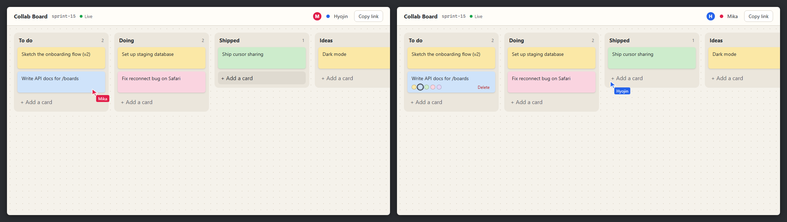

# Collab Board


A small Trello style board. Several people can edit the same board at once and see each other's cursors, and edits merge without conflcts. If your connection drops you can keep working. Your changes stay in the browser and sync when you're back online.



What it does:

- Add, edit, color, delete and drag cards between columns
- Add and rename columns
- Live cursors with names and colors for everyone on the board
- Every board has its own link (`/b/<id>`), so sharing is just copying the URL
- Works offline and shows the connection status (Live, Connecting, Offline)
- The server saves boards to PostgreSQL

## Running it

With Docker (web app, sync server and Postgres):

```bash
docker compose up
```

Then open http://localhost:8080.

Without Docker you need Node 24 and pnpm:

```bash
pnpm install
pnpm dev
```

This starts the web app on http://localhost:5173 and the sync server on port 1234. If `DATABASE_URL` isn't set, the server keeps boards in memory, which is fine for trying it out. To use Postgres, copy `apps/server/.env.example` to `apps/server/.env` and fill in your connection string.

Tests:

```bash
pnpm test
```

## How it works

```
apps/web         React + TypeScript (Vite)
apps/server      Node sync server (ws + y-protocols)
packages/shared  board data model, used by the web app and the tests
```

- Each board is a [Yjs](https://yjs.dev) document. Yjs is a CRDT, which means two people can change the same data at the same time and both copies still end up the same once they've seen each other's changes, without the server picking a winner.
- Cards and columns live in Y.Maps keyed by id. Order comes from a `position` number instead of an array, so moving a card only changes two fields. If two people drag the same card at the same time, one move wins and the card never shows up twice.
- The browser connects to the sync server with the standard `y-websocket` client. The server is my own small implementation of the same protocol: it keeps one room per board, relays updates and cursor positions (Yjs calls this "awareness") to everyone else in the room, and removes your cursor when you disconnect.
- Offline support comes from `y-indexeddb`, which keeps a copy of each board in the browser. When the socket comes back, Yjs exchanges only the changes each side is missing.
- The server stores every update as a row in Postgres. After 100 updates, or when the last person leaves a board, it merges them into one snapshot row. The store sits behind a small interface, so the tests use an in-memory version and the Postgres version is tested against PGlite (Postgres compiled to WebAssembly).

The integration test starts the real server in the test process, connects several Yjs clients, has them edit at the same time, takes one offline, makes conflicting changes on both sides, reconnects, and checks that every client ends up with the same board.
